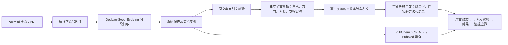

# SenoMiner-AI：论文实验信息提取

输入抗衰老相关论文的 PDF、DOI 或 PMID，提取**本论文实际研究、并报告抗衰老相关积极效果的化合物**。每项结果回答四个问题：原文在哪里说有效、实验怎么做、结果是什么、结论适用于什么模型。

本工具用于整理作者报告的实验，不负责证明药物具有临床抗衰老效果。程序仍读取全文并检查药物角色和原文引文，避免把诱导剂、对照、其他论文的结果当作本篇发现；这些检查在后台执行，网页呈现整理后的化合物与实验解读。“HSP90 inhibitors”等类别名称保留在原始报告中，不能作为一个具体化合物进入列表。

## 第一次使用

1. 双击 [启动项目.command](启动项目.command)，不要关闭启动终端。打开 [本地目录页](http://127.0.0.1:8766/catalog)。本项目固定使用 `.conda/SenoMiner_AI`（Python 3.11.15）和包 `chem-pdf-extractor 0.4.0`。
2. 列表按**文献读取时间从新到旧**排列，显示化合物名称、可拖动旋转的 **3D 分子结构**和完整来源论文名；底部可以选择页码和每页条数。联合用药分别显示各组分的结构，不能将联合结果归给其中单药。
3. 添加论文有两种方式：在右侧选择 PDF，点“上传并提取”（已有待提取文件可直接点“提取这篇 PDF”）；或在上方输入完整 DOI / PMID，点“按编号直接提取”。关键词检索则先点“查找文献”，再选择“提取公开全文”。全文会发送到 `.env` 配置的云端模型，联网调用可能产生费用。
4. 右侧“提取进展”显示文件名、当前阶段、已完成分段数与耗时。流程为读取 → 分段提取 → 核对原文 → 关联实验 → 查询数据库 → 保存。数字只代表实际完成的分段，不是预测总进度；等待云端时耗时仍更新。失败后点“重试并继续”，会复用成功分段。已完成文件默认折叠。
5. 点“查看详情”，最上方默认显示**分子结构与数据库信息**：3D 分子图、分子式、分子量和 PubChem/ChEMBL 链接。下面依次阅读**原文依据、实验步骤、实验结果、结论**。同篇其他实验、完整参数和 PubMed 拓展文献按需展开。
6. 所有网页操作集中在这一页：上传或查找论文 → 查看提取进展 → 浏览化合物列表 → 阅读详情。不再提供原始提取记录展示页和复杂 PDF 工作台。结束时在启动终端按 **Control+C**。汇报或复现实验前，回原论文核对图表、Methods 与补充材料。

DOI 是文献标识符，不保证能下载全文。系统通过 DOI 精确定位 PubMed，再获取 PMC 公开全文；只有题录或摘要时会显示“需要 PDF”，不会用摘要生成完整实验步骤。找不到对应 PubMed 记录的 DOI 也可以上传 PDF。实时文献与化合物数量以网页为准。

两个实际纠错例子：Piceatannol 论文中的 **5-FU 用于诱导衰老**，其 SA-β-gal 与氧化应激增加不是抗衰老药效；目录保留被验证的 Piceatannol，排除 5-FU。另一篇 abemaciclib/LLOMe 论文主要研究癌细胞溶酶体脆弱性及治疗敏感化，abemaciclib 为诱导/预处理，序贯方案不能作为一个抗衰老化合物条目。GCV 依赖 p16-3MR/HSV-TK 自杀基因的清除对照同样排除。

## 它如何实现



- `biology.py` 定义字段与提示词：先识别同一队列、干预、对照和时间窗；不同检测终点可以是同组下的多条结果。模型须区分 `in_vitro`、`ex_vivo`、`in_vivo`、`clinical`，以及剂量分母、给药途径和频率。SA-β-gal、p16、p21 下降仅是标志物变化，不能自动称为衰老细胞被清除。
- `biomedical.py` 将全文按约 8,000 字符分段并保留重叠，用当前 `.env` 的火山方舟 `doubao-seed-evolving` 产生原始记录。`validation.py` 将结果和步骤的逐字引文定位回 `source.md`，并保存待复核状态。
- `claim_review.py` 以整篇原文重新审查各候选和具体记录，区分有效干预、衰老诱导剂、对照、机制探针及癌症治疗结果。它要求明确的抗衰老作用方向、原文效果句、具体实验 ID 及连续结果引文；未完成、证据不匹配或来源变化时暂不收录。复核使用当前配置模型的另一次调用，并非另一个模型或已验证的科学裁判。
- `evidence_cards.py` 对通过角色复核的名称，从整篇原文重新提取效果句与支持它的同一个实验；不把旧记录中混在一起的凋亡、Western blot、机制变化直接当实验卡。每张卡包含对象、剂量、时间、给药、检测、对照和对应原文，多个指标作为同卡子项。引文找不到、模型或检测方法未定位时不展示该卡。
- 剂量、时间、样本量必须逐字出现在对应原文引文中，否则留空。对象/检测方法若被模型概述，只在相关原文描述能完整定位时显示该段原文，丢弃模型改写。格式不合格的参数最多修复一次，仍然执行逐字核对。`catalog.py` 只从这些证据卡建目录；第一遍原始候选用于追溯，不直接组成页面。
- `experiment_groups.py` 提供剂量口径及结果类别等展示辅助。`evidence_cards.py` 以已经定位的对象、方法、图、处理与造模原文建立卡身份，合并相同卡的多个结果，避免把不同造模或队列仅凭相同药物和剂量合并。Hickson 的同一人体给药队列合并组织和循环指标；其他设计仍需核查。
- `evidence_story.py` 从已核验的实验组中选择一条核心原文结果句，生成供阅读的四段式摘要。Hickson 2019、Fisetin 2018、Chang 2016 与本地 Piceatannol 示例的阅读摘要经过同篇原文锚点核验；对其他新论文使用保守的通用选择，仍需人工核对。原始多指标记录保留供追溯，不再作为首页的“实验数”。
- 剂量显示区分 **500 ppm = 每千克饲料含 500 mg**，与 **100 mg/kg 体重口服灌胃**。不会把前者当作小鼠每日每千克体重 500 mg。内部区分寿命、炎症/SASP、器官指标或衰老标志物，默认界面不显示这组分类标签；只有直接的细胞死亡/凋亡证据才可支持清除推断。
- `structures.py` 优先取 PubChem 3D SDF；没有构象时取相同 CID 的化学结构，用固定版本 RDKit 的 ETKDGv3 生成三维坐标，并验证分子图和立体化学未改变。页面明确标注 PubChem 构象与 RDKit 计算构象；后者用于展示，不是实验测定或对接验证结果。SDF 和来源信息缓存于 `output/.structure_cache/`。首页使用可拖动的 Canvas 预览，同页结构请求共享缓存，后台刷新不重建未变化的分子图。详情展开数据库资料后，可使用 Canvas 或本地 `3Dmol.js` WebGL 模式。
- 读取时间保存在新报告的 `read_at`；旧报告采用原始 `report.json` 完成时间。化合物按其最新来源文献的读取时间排序，复核或缓存更新不会使旧论文跳到顶部。同一确认 CID 的别名聚合，组合仍按各组分区分。

原 [Chem-PDF-Extractor](https://github.com/myklovenyzforever/chem-pdf-extractor) 提供 PDF 解析、模型调用和导出基础；[LLM-TPD-Extraction](https://github.com/yaochenr/LLM-TPD-Extraction) 提供生物实验信息抽取参考；[Google DeepMind Science Skills](https://github.com/google-deepmind/science-skills) 的 PubChem、ChEMBL、PubMed 包装脚本保留在 `vendor/`。第三方版本和许可证见 [第三方来源](docs/第三方来源.md)。

## 项目结构与数据文件

```text
启动项目.command                 双击启动本地网页
run_senolytics.py                校验虚拟环境、读取 .env、启动程序
.conda/SenoMiner_AI/             固定 Python 3.11.15 虚拟环境
.env                             本机模型与密钥；不会进入 Git
input_pdfs/                      用户上传或下载的原论文 PDF
output/                          每篇原始报告、表格与 PDF/结构缓存
chem_pdf_extractor/
  sources.py, pdf.py              获取 PMC 全文 / PDF 转 Markdown
  biology.py, llm.py              字段、抽取规则和云端模型调用
  biomedical.py                   分段、恢复、逐篇提取与导出
  validation.py                   原文引文与步骤字面核验
  claim_review.py                 独立全文复核、角色判断及收录理由
  evidence_cards.py               从全文重新关联效果句与支持实验，核对参数原文
  enrichment.py, science_skills.py PubChem/ChEMBL/PubMed 增强
  catalog.py                      本篇实验收录、跨论文聚合、3D 数据
  structures.py                   PubChem 3D / RDKit 构象与来源缓存
  experiment_groups.py            剂量口径、模型类型与结果类别辅助
  evidence_story.py               原文依据、实验步骤、结果、结论四段式摘要
  server.py                       本地 API、任务与页面
  catalog_progress.py             当前任务、真实分段计数、耗时与失败状态
  network.py                      使用当前环境的 CA 证书进行严格 HTTPS 校验
  templates/catalog.html          目录页面骨架
  static/catalog.css, catalog.js  简洁页面与 3D 兼容渲染
  static/3Dmol-min.js             本地 WebGL 分子绘图库
vendor/                           第三方脚本与许可证
tests/                            无需真实密钥的自动测试
docs/                             开发流程与来源说明
```

原“原始提取记录”页面用于开发排查，会显示尚未经过筛选的模型候选，容易与正式结果混淆，因此已移除该页面及下载/启动接口。原始文件保留在本地供追溯。每篇论文的 `report.json` 是未经人工判定的**原始候选**；`source.md` 是字面引文定位基准；`experiments.jsonl` 和 `experiments.xlsx` 便于脚本及人工审查。`claim_review.json` 单独保存角色复核决定与分子身份，`evidence_cards.json` 保存从全文重新关联的实验卡及每个参数的原文。它们绑定全文、关键候选字段和已通过名称，避免复用其他版本的结果；模型原始响应也保留供审查。Chang 2016 的 `report.revalidated.json` 是先前保留的字面核验副本，不直接进入页面。原始 `report.json` 不覆盖。模型缓存、结构缓存、论文、输出和 `.env` 均被 `.gitignore` 排除。

需要对已有报告重新复核时，在项目根目录运行（使用 `.env` 的模型，可能产生 API 费用）：

```bash
.conda/SenoMiner_AI/bin/python -m chem_pdf_extractor.claim_review --output-root output --workers 2
```

该命令复用同源、同规则的成功复核缓存；失败的复核会重试。具体参考的文献精读项目和备份逻辑见 [开发说明](docs/开发说明.md)。


这个系统把文献检索、实验抽取、数据库增强和证据展示串联起来，解决“同一篇论文的不同终点被当成独立实验”的展示问题。它采用论文和队列作为边界，不能把 Fisetin 动物/离体数据混成 2019 年 D+Q 人体试验的证据。自动分组、图号识别、模型语义标签、PDF 转文字和引文修复仍可能漏报或误归组；目前没有人工 Gold 数据，不能宣称提取召回率或精确率，也不能把它当作直接可复现实验方案。

更详细的字段、接口、示例纠错和扩展方式见 [开发说明](docs/开发说明.md)。

## 网络报错与重试

项目文件夹改名后，Conda 的编译时默认证书路径可能仍指向旧文件夹，引发 `CERTIFICATE_VERIFY_FAILED`；旧提示会将它包装成 `Cloud API/network temporarily unavailable after retries.`。程序现使用原虚拟环境中的 `certifi 2026.10.23` CA 文件，保持主机名与证书校验，不需要关闭 HTTPS 校验或重建环境。显式配置的 `SSL_CERT_FILE` / `SSL_CERT_DIR` 仍优先，需由其配置者保证有效。

普通网络超时会有限重试；只有结构化响应不完整才拆分片段，网络故障不会递归拆分并放大请求。成功片段保存在该论文的 `extraction_cache/`，再次提取时复用。原始报告保存后，如果全文核对或实验关联失败，任务仍显示失败并允许继续，不会误标完成。

## 开发检查

```bash
.conda/SenoMiner_AI/bin/python -m pip check
.conda/SenoMiner_AI/bin/python -m unittest discover -s tests -v
.conda/SenoMiner_AI/bin/python -m chem_pdf_extractor --help
.conda/SenoMiner_AI/bin/python -m chem_pdf_extractor.biomedical --help
git diff --check
```
