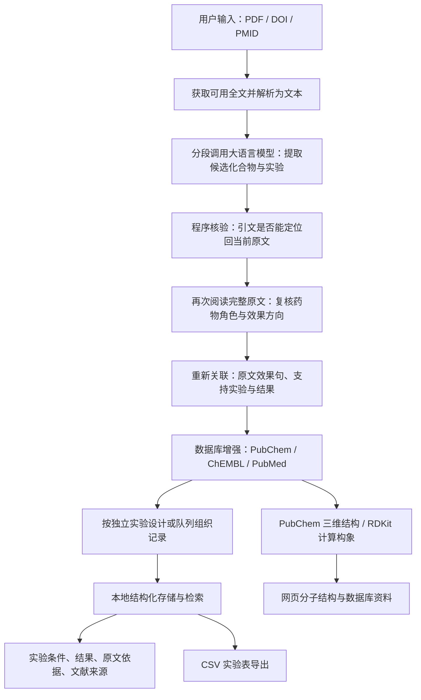

# SenoMiner-AI 项目实现报告

**项目方向：基于大语言模型的抗衰老化合物文献挖掘与结构化实验数据库**

**报告日期：2026 年 10 月 28 日**

**当前项目声明：`chem-pdf-extractor 0.4.0`；运行环境：`SenoMiner_AI`，Python `3.11.15`。**

本文按当前已实现的流程介绍项目，用于说明系统如何工作、使用哪些技术、复用了哪些开源成果，不展开逐个代码文件。

## 一、项目要解决什么问题

抗衰老论文中的信息通常分散在 Results、Methods、图注及补充材料中。只检索“化合物名称”或让模型总结摘要，容易出现三类问题：把造模药物或对照药物当成有效化合物，把其他论文的发现当成本篇发现，以及把同一实验的多个检测指标重复列为多个实验。

本项目的目标是：

> 输入一篇论文，找出本论文实际研究、并报告抗衰老相关积极效果的具体化合物，关联支持该结论的实验对象、处理条件、检测方法、结果和原文证据，形成可以检索和追溯的实验记录。

因此，系统的最终产物是**带原文依据的结构化实验数据库原型**。它整理作者报告的结果，保留证据适用范围；论文在细胞或小鼠中观察到效果，不能据此写成人体抗衰老疗效。

## 二、系统总体架构

系统由四部分组成：本地网页、Python 处理流程、云端大语言模型，以及外部生物医学数据库。本地保存输入论文、中间记录和最终数据，网页负责输入、进度、检索与展示。

图中的两条信息来源需要区分：**实验结论来自当前论文，分子属性与拓展文献来自外部数据库。** 外部资料不回填成本篇论文的实验结果。

## 三、完整实现流程

### 1. 输入论文并取得全文

用户可以上传本地 PDF，也可以输入 DOI、PMID，或通过关键词检索选择文献。

- **PDF 路径：**在本地解析论文，转换为后续处理使用的文本或 Markdown。
- **编号路径：**先定位 PubMed 题录，再尝试获取 PMC 的公开全文。DOI 检索采用精确标识匹配。
- **全文不可得：**提示补充 PDF；不会仅凭摘要生成完整实验流程。

系统保存本次实际读取的原文，后续所有引文定位均以这份文本为基准。正文、Methods 和图注能否完整解析，会直接影响后续提取。底层提取入口可以接收补充文档，但这不等于系统已经能够自动找齐每篇论文的全部补充材料。

### 2. 分段提取候选化合物和实验信息

当前配置使用火山方舟的 **Doubao-Seed-Evolving**，模型标识为 `doubao-seed-evolving`。论文文本通过兼容 OpenAI 接口格式的 HTTPS 请求发送到模型。

长论文按约 **8,000 个字符**分段，相邻段保留约 **1,200 个字符**的重叠，降低跨段信息被切断的风险。当前网页流程允许有限的分段并行调用，并保存成功片段供失败后恢复。

模型按照预先定义的实验字段输出结构化记录，主要包括化合物、实验模型、处理条件、检测结果及对应原文。程序使用 Pydantic 等机制解析和检查输出结构。

这一阶段尽量收集候选信息，**初次提取结果还不能直接作为正式收录结果**。

### 3. 将模型引文定位回原文

程序检查模型提供的结果句、参数引文及步骤引文，确认它们能在当前保存的原文中找到，并保留可用的位置线索。

这一步用于阻止模型生成不存在的引文，也为后续人工回查提供依据。但“原句存在”只说明引用有出处，尚不能证明模型正确理解了句子的实验角色。

例如，一句话真实描述了某药物使衰老标志物升高，它可能是在说明造模成功，而不是抗衰老有效。因此还需要下一步的全文复核。

### 4. 再次阅读全文，判断药物角色和效果方向

程序把完整原文和候选信息交给模型进行另一轮复核，重点核对：

1. 该化合物是否由本论文实际进行实验研究。
2. 它是活性干预、衰老诱导剂、对照，还是背景引用。
3. 结果方向是否属于抗衰老相关积极效果。
4. 是否有明确的支持实验和原文结果句。
5. 是否只是癌细胞治疗敏感性变化，或依赖特殊转基因清除系统的对照结果。

只有符合收录条件并通过后续证据关联的具体化合物，才进入正式目录。类似“HSP90 inhibitors”的类别名称不能当作一个具体分子收录。

这里的“复核”是**同一配置模型的另一次调用，加上程序约束**，不是第二个独立模型的认证，也不能保证消除全部误判。

### 5. 关联效果句、实验过程与实验结果

通过角色复核后，系统再从全文中提取支持该化合物效果的实验卡，把 Results 中的发现与 Methods、图注中的条件联系起来。

每个实验记录主要整理以下信息：

| 信息类别 | 记录内容 |
| --- | --- |
| 实验对象 | 细胞系、动物模型、离体组织或人体研究对象 |
| 实验类型 | 体外、离体、动物体内、人体给药研究 |
| 造模与预处理 | 诱导剂、诱导剂量与时间、恢复培养 |
| 活性干预 | 被研究化合物的浓度或剂量、处理时间、给药方式 |
| 实验设计 | 对照、样本量、检测方法 |
| 实验结果 | 作者观察到的变化、可提取的定量及统计结果 |
| 证据与来源 | 原句、章节或图号、论文题名、DOI、PMID |

诱导剂条件与活性药物条件分开保存。例如，不能把 5-FU 的造模浓度当成 Piceatannol 的治疗浓度。剂量还要保留分母和给药含义，饲料中的 mg/kg 与按体重给药的 mg/kg 不能直接等同。

数值字段必须有对应原文支持；不能可靠核验时留空。网页显示“未提取”，表示系统没有可靠取得该字段，不能据此断言论文未报告。实验步骤也需要原文依据，不能从一句结果描述中自行补写操作过程。

### 6. 以独立实验为单位组织数据

数据采用三级关系：

> 化合物或联合用药 → 来源论文 → 独立实验记录。

同一个实验内部还可以包含多个检测结果和操作步骤。例如，同一批小鼠的寿命、生化和病理结果可以挂在同一个实验下；不同队列、基因型、造模方式或给药时间窗，则应保留为不同实验。

这样做既保留实验信息，也避免把同一实验的十个指标展示成十次独立验证。当前系统根据已定位的对象、处理条件、造模信息和图文证据建立实验身份并合并重复记录；复杂实验之间的关联仍需要人工核对。

联合用药保留组合身份。查询各组分的分子属性，不代表可以把组合实验的效果分别归给每一种单药。

### 7. 查询外部数据库，补充分子身份和拓展资料

系统通过三个 Science Skills 的 Python 包装脚本查询数据库。

| 数据库 | 在本项目中的作用 | 不能据此做出的推断 |
| --- | --- | --- |
| PubChem | 解析化合物名称，取得 CID、分子式、分子量、同义名及结构标识 | 数据库中存在该化合物，不代表它有抗衰老药效 |
| ChEMBL | 关联分子编号，查询可获得的生物活性、机制等资料 | 其他研究的活性记录不能替代本篇实验 |
| PubMed / PMC | 文献定位、题录与公开全文获取，以及相关论文检索 | 相关论文的结果不能混入当前论文结论 |

名称先尝试解析为唯一 PubChem CID，再用完整 InChIKey 关联 ChEMBL；身份不明确时保留未解析或歧义状态，避免凭相近名称任意指定结构。

数据库查询使用缓存、超时和错误状态处理。化合物名称、分子式和结构主要来自 **PubChem**；PubMed 主要承担文献检索，两者职责不同。

### 8. 生成分子三维展示，保存并提供查询

三维结构优先使用 PubChem 提供的 SDF 构象。没有可用三维构象时，读取同一 CID 的化学结构，通过 RDKit 的 **ETKDGv3** 生成坐标，并在条件允许时使用 **MMFF / UFF** 优化。生成前后检查分子图与立体化学是否保持一致。

网页使用本地 **3Dmol.js + WebGL** 渲染球棍或空间填充模型，支持旋转和缩放；浏览器不支持时采用 Canvas 兼容显示。模型根据化学坐标渲染；计算构象与 PubChem 构象分别标注来源，计算构象不等于实验测定结构。

最终数据保存为本地 JSON 等文件，再形成统一的结构化记录视图。网页提供跨论文列表、分页、关键词与实验类型筛选、详情展开及 CSV 导出。分子资料位于详情顶部，实验条件和结果以表格呈现，详细操作及更多原文按需展开。

筛选条件必须命中**同一条实验记录**，不能把甲实验的模型和乙实验的剂量拼成一个匹配结果。

## 四、使用的技术栈

| 层次 | 当前技术 | 具体用途 |
| --- | --- | --- |
| 运行环境 | Python 3.11.15；固定 `SenoMiner_AI` 虚拟环境 | 保持项目和第三方查询脚本使用同一环境 |
| 本地服务 | Python 标准库 HTTP 服务、线程与线程池 | 页面与 API、后台任务、受控分段并行、进度状态 |
| 网页界面 | HTML、CSS、原生 JavaScript、Fetch API | 上传、检索、进度轮询、实验表与详情；当前界面不依赖 Vue/React |
| 文档解析 | PyMuPDF4LLM、PyMuPDF、pypdf | PDF 转文本或 Markdown；解析模式可配置 |
| 模型服务 | 火山方舟 Doubao-Seed-Evolving；兼容 OpenAI 格式的 HTTPS 接口 | 候选抽取、全文角色复核、实验关联 |
| 数据结构检查 | Pydantic、JSON 解析、项目自定义校验规则 | 约束返回字段，检查引文、参数及来源 |
| 数据库接入 | Science Skills 中的 PubChem、ChEMBL、PubMed 脚本 | 访问外部数据库；由项目 Python 子进程调用 |
| 化学结构处理 | RDKit 2026.9.1 | 校验化学结构、生成三维构象、检查身份一致性 |
| 三维显示 | 3Dmol.js 2.5.5、WebGL、Canvas | 分子立体模型与浏览器兼容显示 |
| 存储与导出 | 本地 JSON / JSONL、CSV；pandas、openpyxl | 原始记录、派生记录、缓存与表格导出 |
| 配置与网络 | python-dotenv、HTTPS、certifi | 本机模型配置与证书校验 |
| 工程验证 | Python unittest、JavaScript 行为检查、浏览器实测 | 验证流程、接口、显示与错误处理 |

项目依赖中还保留 LangChain / Ollama 适配能力，供本地模型调用路径使用。**当前豆包云端主流程直接发起兼容接口请求，不依赖 LangChain 的 Agent 编排。**

当前没有部署 MySQL、PostgreSQL 或向量数据库；“实验数据库”指已实现的数据组织、检索和展示能力，存储基础仍是本地文件。也没有训练或微调新的模型。

## 五、哪些开源项目和 Skills 被组合使用

本项目是在现有基础上进行二次开发、复用查询脚本，并自行补充实验证据处理流程。不同来源的使用程度如下。

| 来源 | 实际采用的部分 | 集成方式 |
| --- | --- | --- |
| [Chem-PDF-Extractor](https://github.com/myklovenyzforever/chem-pdf-extractor) | PDF 解析、模型调用、结构化提取、导出与任务处理基础 | **二次开发基础**；原化工提取方向改造为生物实验提取，当前展示页重新组织 |
| [LLM-TPD-Extraction](https://github.com/yaochenr/LLM-TPD-Extraction) | 生物实验字段、实验记录和提示词设计 | **设计参考**；保留参考提示词，未运行其 PROTAC 专用完整管线 |
| [Google DeepMind Science Skills](https://github.com/google-deepmind/science-skills) | PubChem、ChEMBL、PubMed 的 Python API 包装脚本及说明 | **实际运行的第三方查询组件**；随项目保存在本地并由固定虚拟环境调用 |
| [3Dmol.js](https://github.com/3dmol/3Dmol.js) | 浏览器分子可视化 | **直接使用的前端库**；本地加载，未引入旧前端整套依赖 |
| [RDKit](https://www.rdkit.org/) | 化学结构处理及构象生成 | **直接使用的 Python 库** |
| [CancerPPD 2.0](https://webs.iiitd.edu.in/raghava/cancerppd2/usr_guide.html) | 基本信息、实验数据、文献来源分区 | **展示与数据组织参考**；未导入其抗癌数据库数据，也未将本项目称为人工整理数据库 |
| 早期备份项目 Original | 主要活性化合物与对照/背景区分、先提取再核验、分子查看器的呈现思路 | **逻辑和界面参考**；未直接恢复整套旧项目 |

其中实际复用的三个 Skills 是：

- **`pubchem-database`：**化合物身份和化学属性查询。
- **`chembl-database`：**生物活性分子与相关信息查询。
- **`pubmed-database`：**文献检索、题录和公开全文获取。

这里的 Skill 包含使用说明和可执行脚本。当前程序主要复用其中的脚本，补充了本项目的调用适配、缓存及错误处理；它们没有安装成全局 Codex Skills，也不是由多个自主 Agent 在运行时自由选择调用。

Evidence Inference、PaperQA2、paper-evidence-map 等项目曾用于比较证据组织思路，但未作为当前运行依赖集成。不能把“调研过的项目”全部列成系统使用的技术组件。

各开源来源的许可证和版本定位已保留在项目的[第三方来源说明](docs/第三方来源.md)中。

## 六、二次开发主要完成了哪些工作

相对于直接运行上游工具，本项目的主要工作集中在以下环节：

1. **重定义提取目标。** 从一般化学实验信息，改为本篇论文的抗衰老活性干预、实验设计、结果及证据来源。
2. **增加药物角色与方向复核。** 不只识别名称，还核对它是在造模、作对照，还是支持本篇积极结论的活性干预。
3. **关联全文实验信息。** 将效果句与对应 Methods、图注和参数引文联系起来，减少仅靠局部段落产生的混合记录。
4. **重建实验粒度。** 采用独立设计/队列下包含多个检测结果的结构，处理重复表述，并保留来源。
5. **接入分子身份与数据库增强。** 保持当前论文实验信息与外部数据库资料分开，保留组合用药关系。
6. **形成可查询的数据库界面。** 增加统一输入、阶段进度、跨论文检索、结构化实验表、三维分子显示及导出。
7. **补充运行可靠性。** 保存成功分段、有限重试、来源指纹与缓存检查，并保留原始输出供追溯。

项目的技术重点是**领域规则、模型调用和可追溯数据组织的结合**。这些工作属于应用系统与流程实现；是否构成方法上的创新，还需要与已有研究比较并通过独立数据集评价。

## 七、一个贯穿流程的例子

以本项目已处理的 Piceatannol 论文为例，其处理关系可以表述为：

> 输入原论文 → 发现 Piceatannol 与 5-FU 等名称 → 阅读原文区分“5-FU 诱导衰老”和“Piceatannol 测试清除作用” → 找到 Piceatannol 的结果句 → 关联造模、恢复培养、活性药物处理和检测过程 → 组织为细胞实验记录 → 查询 Piceatannol 的分子资料 → 展示实验表、原文及来源。

这里 5-FU 可以保留在实验的“诱导剂”字段中，但不能因为出现了显著实验变化就进入有效化合物目录。同一实验的 Annexin V、SA-β-gal、CCK8 等检测信息归入该实验，不因检测方法不同就重复生成几次独立验证。

这也说明：项目的关键不只是让模型读出更多名词，而是把**化合物角色、实验条件、结果方向和支持证据对应起来**。

## 八、当前验证与局限

工程层面已完成 254 项 Python 自动化测试，并进行了 JavaScript 行为检查与浏览器实测。覆盖内容包括提取与接口处理、引文约束、数据库身份、筛选导出、安全检查，以及三维显示与兼容回退。工程测试通过不能换算成科学提取准确率。

现阶段仍有以下限制：

- 尚无独立人工标注测试集，不能报告可靠的提取准确率、召回率或实验覆盖率。
- 模型可能误解角色、漏掉实验，或把不同队列关联错误；原文字面核验不能独立解决这些语义问题。
- 部分已有示例包含同篇原文锚点约束下的案例整理规则，不能将这些案例效果当成对任意新论文的泛化能力。
- PDF 排版、表格、扫描件、图片中的实验结果及缺失补充材料会影响完整性；当前不能宣称完整理解所有图表。
- 外部查询和模型调用依赖网络、数据库可用性与模型服务，并有调用时间和费用。

下一步适合先建立人工标注样本，分别评价化合物角色判断、实验归组、关键参数与引文对应的正确性，再决定是否引入更复杂的检索或 Agent 框架。

## 九、向老师汇报时可以这样概括

> 我的项目是一个抗衰老化合物文献实验数据库原型。它以 Chem-PDF-Extractor 为二次开发基础，借鉴 LLM-TPD-Extraction 的生物实验字段设计，使用豆包大语言模型分段读取论文。提取后，程序先核对原文引文，再通过全文复核区分活性药物、诱导剂和对照，并把结果句与支持它的实验过程重新关联。随后将同一实验的多个指标归到同一条实验记录，利用 Science Skills 中的 PubChem、ChEMBL 和 PubMed 脚本补充分子及文献信息，最后用本地网页和 3Dmol.js 展示与检索。现阶段的重点是准确整理本篇论文报告的实验及其来源，后续需要人工标注数据评价提取质量。

若被问到“是不是多 Agent 或 RAG 项目”，当前准确表述是：**采用预先编排的多阶段 LLM 处理流程，带有分段并行和原文证据核验；尚未实现自主多 Agent 协作，也没有采用向量检索驱动的 RAG 架构。**
